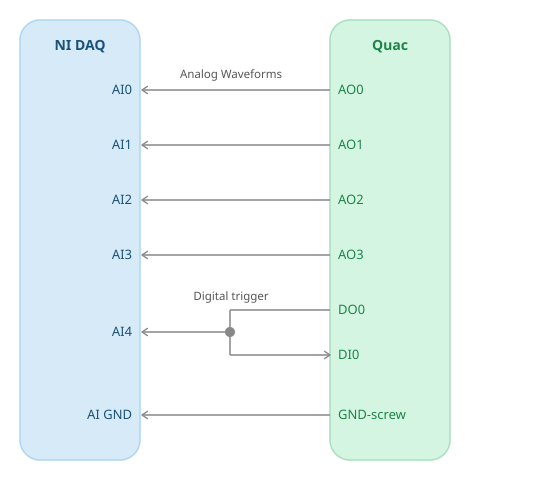

# Quac_Benchmarking
This repository contains the Bonsai-rx workflow and instructions to run the benchmarking test of the Harp.Quac device. 

Setup:
1. Firmware - This workflow was written and tested with:
    - Firmware: v1.0.0
    - Hardware: v1.0.0
    - download firmware 1.0.0 .uf2 file from: https://github.com/AllenNeuralDynamics/harp.device.quac/releases
    - upload firmware, by pressing and holding "bootsel" button, connecting power and USB and finally drag and dropping .uf2 file on device.
2. SD-card waveforms:
    - run gen_waveform.py to generate the waveforms used to benchmark SD-card playback.
    - upload generated waveforms to SD card (requires SD-card reader), then reinsert SD into Quac.
3. Wiring:
    - connect the four AO-channels to four of the AI-channels of your NI-DAQ (signal and ref.)
    - connect DO0 to DI0 (used for triggering), with a T-piece to connect a copy of the trigger to the fifth AI channel of your DAQ. 

    

4. Workflow configuration:
    - open the QuacTest.bonsai 
    - configure the recording channels to match the five AI-channels you connected to the Quac
    - set the sampling-rate per channel to 1MHz or the highest supported by your NI-DAQ
    - set the COM-port of the Quac
    - update filenames if required. By default Recording001.bin for NI-DAQ and Quac001.bin for Harp messages, increment if you want multiple recordings
5. Run!
    - let me know of any issues you run into and we'll figure it out:)
    - or else let me know it ran successfully and we'll see what's the easiest way to share the data (OneDrive/Dropbox etc.).

General notes:
- Install Bonsai environment using Setup.cmd
- You need a Python environment to generate waveforms (e.g.: using a uv .venv)
- DAQ will require a USB 3 port connection (Quac can use any USB port)
- Quac requires it's own power supply
- AIs are recorded in differential mode. This generally works well, but if your external trigger looks particularly noisy, you can try connecting or disconnecting this signal against the AI-GND. 